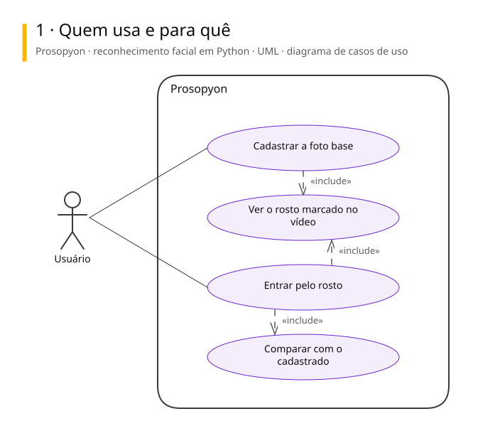
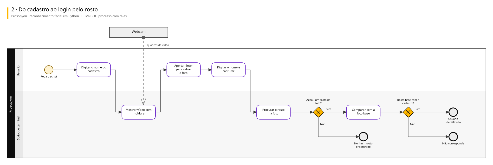
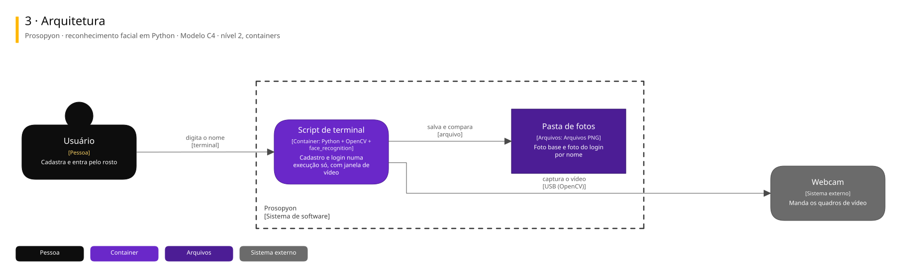

# Arquitetura

Três vistas do sistema, cada uma numa notação padrão.

| Vista | Notação | Responde |
|---|---|---|
| 1. Casos de uso | UML | Quem usa e para quê |
| 2. Processo | BPMN 2.0 | Como o trabalho anda, com uma raia para cada quem executa |
| 3. Arquitetura | C4, nível 2 | De que partes o sistema é feito e com quem conversa |

## Prosopyon · reconhecimento facial em Python

Experimento de estudo, arquivado: um script de terminal que cadastra o rosto pela webcam e, em seguida, confere no login se o rosto bate com o cadastrado. Tudo roda numa execução só, sem banco: as fotos ficam em PNG numa pasta.

### 1. Quem usa e para quê

### 2. Do cadastro ao login pelo rosto

### 3. Arquitetura

Para editar: [prosopyon.excalidraw](./prosopyon.excalidraw), que abre em [excalidraw.com](https://excalidraw.com) ou na extensão Excalidraw do VS Code.

## De onde vêm

Os diagramas são gerados a partir do Sinapse, o vault onde o Pedro organiza notas e projetos. Mudança feita direto aqui some na próxima publicação: o lugar de mudar é a especificação no Sinapse.
