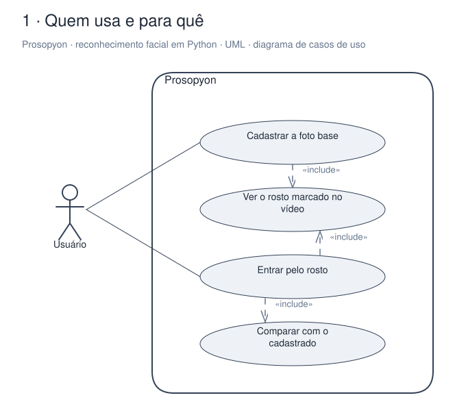
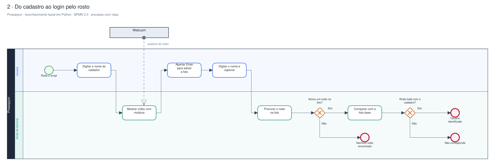
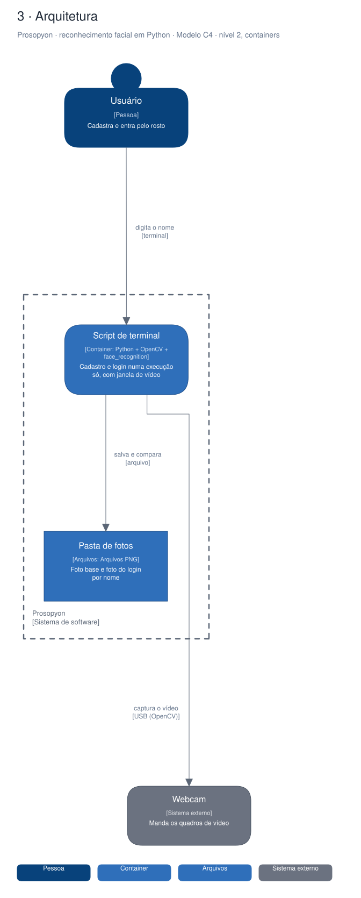

# Arquitetura

Diagramas gerados a partir do Sinapse (o segundo cérebro do Pedro). Cada projeto tem três vistas,
cada uma numa notação padrão:

1. **Quem usa e para quê**: UML, diagrama de casos de uso.
2. **O processo principal**: BPMN 2.0, com raias por quem executa.
3. **A arquitetura**: modelo C4, nível 2 (containers).

## Prosopyon · reconhecimento facial em Python

Experimento de estudo, arquivado: um script de terminal que cadastra o rosto pela webcam e, em seguida, confere no login se o rosto bate com o cadastrado. Tudo roda numa execução só, sem banco: as fotos ficam em PNG numa pasta.

### Quem usa e para quê (UML)

### Do cadastro ao login pelo rosto (BPMN 2.0)

### Arquitetura (C4, containers)

Editável: [`projeto-prosopyon.excalidraw`](./projeto-prosopyon.excalidraw), abre em [excalidraw.com](https://excalidraw.com) ou no VS Code com a extensão Excalidraw.

A fonte destes arquivos é o vault do Sinapse (`09-DESENHOS/`); alterações feitas aqui são sobrescritas na próxima publicação.
